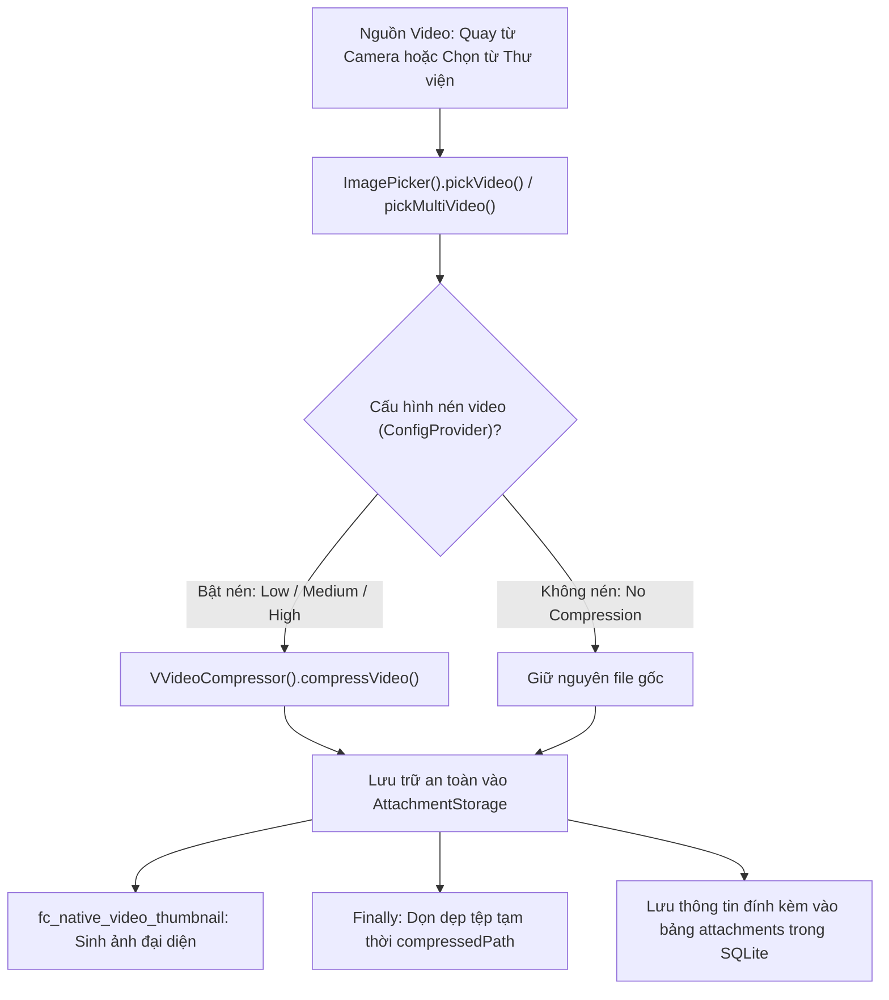
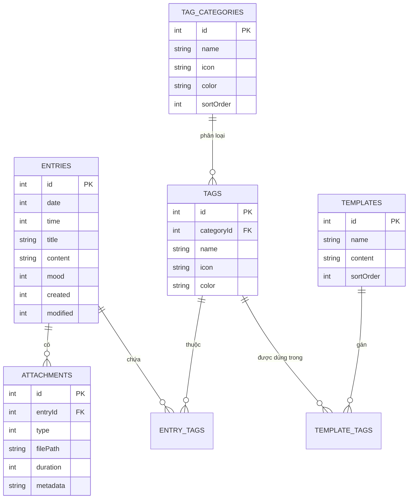

# BÁO CÁO PHÂN TÍCH SOURCE CODE VÀ TÍNH NĂNG ỨNG DỤNG DAILY YOU

> **Học phần:** Lập trình Thiết bị Di động / Phát triển Ứng dụng  
> **Sinh viên thực hiện:** Phạm Văn Hùng (pvhung2112)  
> **Dự án phân tích:** Daily You (Flutter Journal Application)  
> **Repository GitHub:** [https://github.com/pvhung2112/Daily_You](https://github.com/pvhung2112/Daily_You)  
> **Ngày thực hiện:** Tháng 11/2026  

---

## MỤC LỤC
1. [GIỚI THIỆU & THU THẬP SOURCE CODE](#1-giới-thiệu--thu-thập-source-code)
2. [CẤU TRÚC DỰ ÁN, CÁC THƯ MỤC VÀ FILE CHÍNH](#2-cấu-trúc-dự-án-các-thư-mục-và-file-chính)
3. [XÁC ĐỊNH VÀ LIỆT KÊ CÁC TÍNH NĂNG CHÍNH CỦA ỨNG DỤNG](#3-xác-định-và-liệt-kê-các-tính-năng-chính-của-ứng-dụng)
4. [PHÂN TÍCH CHUYÊN SÂU CÁC CƠ CHẾ CỐT LÕI](#4-phân-tích-chuyên-sâu-các-cơ-chế-cốt-lõi)
   - 4.1. [Cách ứng dụng xử lý Video và Đa phương tiện](#41-cách-ứng-dụng-xử-lý-video-và-đa-phương-tiện)
   - 4.2. [Cách ứng dụng quản lý Dữ liệu và Cơ sở dữ liệu](#42-cách-ứng-dụng-quản-lý-dữ-liệu-và-cơ-sở-dữ-liệu)
   - 4.3. [Kiến trúc Giao diện Người dùng (UI/UX)](#43-kiến-trúc-giao-diện-người-dùng-uiux)
5. [PHÂN TÍCH VIỆC SỬ DỤNG CÁC THÀNH PHẦN THIẾT BỊ DI ĐỘNG](#5-phân-tích-việc-sử-dụng-các-thành-phần-thiết-bị-di-động)
6. [ĐÁNH GIÁ KIẾN TRÚC MÃ NGUỒN & KẾT LUẬN](#6-đánh-giá-kiến-trúc-mã-nguồn--kết-luận)

---

## 1. GIỚI THIỆU & THU THẬP SOURCE CODE

### 1.1. Nguồn gốc dự án
Ứng dụng **Daily You** là một ứng dụng viết nhật ký cá nhân nguồn mở hiện đại, được xây dựng trên nền tảng **Flutter SDK** và ngôn ngữ **Dart**.
- **Tác giả gốc:** Demizo và cộng đồng mã nguồn mở.
- **Repository gốc:** [https://github.com/Demizo/Daily_You](https://github.com/Demizo/Daily_You)
- **Giấy phép bản quyền:** GNU General Public License v3.0 (GPL-3.0) kèm các điều khoản bổ sung (`ADDITIONAL_TERMS.md`).
- **Phiên bản phân tích:** v3.7.0+3007000 (`pubspec.yaml`).
- **Nền tảng hỗ trợ:** Android (trọng tâm chính), Linux, Windows.

### 1.2. Triết lý thiết kế cốt lõi
Qua việc phân tích sâu mã nguồn, Daily You được xây dựng xoay quanh 3 triết lý then chốt:
1. **Offline-First & Privacy by Design:** Ứng dụng hoạt động 100% cục bộ trên thiết bị người dùng. Thậm chí trong tệp `android/app/src/main/AndroidManifest.xml`, tác giả đã chủ động cấu hình gỡ bỏ quyền mạng:
   ```xml
   <uses-permission android:name="android.permission.ACCESS_NETWORK_STATE" tools:node="remove"/>
   ```
   Ứng dụng hoàn toàn không gửi bất kỳ dữ liệu nào của người dùng lên máy chủ bên ngoài.
2. **Không khóa dữ liệu người dùng (No Vendor Lock-in):** Toàn bộ dữ liệu nhật ký có thể xuất sang định dạng mở chuẩn như Markdown, ZIP kèm media, JSON, CSV hoặc chuyển đổi tương thích với các app lớn như Day One, Journey, Diaro.
3. **Hiện đại & Đẹp mắt:** Ứng dụng tận dụng ngôn ngữ thiết kế Material 3 mới nhất với bảng màu động (Dynamic Color / Material You trích xuất từ hình nền Android).

---

## 2. CẤU TRÚC DỰ ÁN, CÁC THƯ MỤC VÀ FILE CHÍNH

### 2.1. Sơ đồ cây cấu trúc tổng thể
```text
Daily_You/
├── android/                         # Cấu hình Native Android (Gradle, Manifest, Services)
│   ├── app/src/main/AndroidManifest.xml
│   └── app/build.gradle
├── packages/                        # Kiến trúc Modular gồm 4 custom plugin nội bộ
│   ├── backup_crypto/               # Thư viện mã hóa sao lưu an toàn (AES-GCM / PBKDF2)
│   ├── external_opener/             # Bộ điều hướng mở file ngoài ứng dụng
│   ├── saf_transfer/                # Sao chép tệp qua Storage Access Framework (SAF)
│   └── share_receiver/              # Nhận Intent chia sẻ văn bản/ảnh/video từ app khác
├── lib/                             # Mã nguồn chính của ứng dụng Flutter
│   ├── database/                    # Quản lý CSDL SQLite và DAO
│   │   ├── app_database.dart        # Khởi tạo DB, quản lý schema migration (v1 -> v6)
│   │   ├── entry_dao.dart           # CRUD bảng nhật ký entries
│   │   ├── entry_attachment_dao.dart# CRUD bảng tệp đính kèm attachments
│   │   ├── tag_dao.dart             # CRUD thẻ bài viết
│   │   ├── tag_category_dao.dart    # CRUD danh mục thẻ
│   │   ├── template_dao.dart        # CRUD mẫu bài viết
│   │   └── attachment_storage.dart  # Trừu tượng hóa lưu trữ file (Nội bộ vs SAF ngoài)
│   ├── models/                      # Các đối tượng dữ liệu (Entry, Attachment, Tag, Template...)
│   ├── providers/                   # Tầng quản lý trạng thái (State Management với Provider)
│   │   ├── entries_provider.dart    # Quản lý danh sách nhật ký, tìm kiếm, lọc
│   │   ├── entry_attachments_provider.dart
│   │   ├── tags_provider.dart
│   │   └── templates_provider.dart
│   ├── pages/                       # Các màn hình người dùng
│   │   ├── launch_page.dart         # Màn hình Splash/Khởi động (kiểm tra quyền, unlock PIN)
│   │   ├── home_page.dart           # Màn hình chính (Lịch dọc + danh sách nhật ký)
│   │   ├── entry_edit_page.dart     # Màn hình soạn thảo nhật ký Markdown
│   │   ├── gallery_page.dart        # Thư viện ảnh/video nhật ký
│   │   ├── insights_page.dart       # Màn hình thống kê tâm trạng, streak, số từ
│   │   ├── flashback_page.dart      # Ký ức "Vào ngày này" (On This Day)
│   │   └── settings/                # Nhóm màn hình cài đặt hệ thống
│   ├── stats/                       # Logic tính toán số liệu thống kê (chuỗi ngày, phân phối tâm trạng)
│   ├── storage/                     # Quản lý Import/Export, chuyển đổi dữ liệu
│   ├── utils/                       # Các tiện ích (mã hóa, nén ảnh/video, auto backup)
│   ├── widgets/                     # Các thành phần giao diện tái sử dụng
│   │   ├── vertical_calendar.dart   # Lịch cuộn dọc tương tác
│   │   ├── editor_action_bar/       # Thanh công cụ Markdown nổi tiện dụng
│   │   ├── zoomable_attachment_page_view.dart # Trình xem ảnh phóng to/thu nhỏ
│   │   └── media_attachment_page.dart # Trình phát video và âm thanh
│   ├── l10n/                        # Bản địa hóa ngôn ngữ (ARB files và generated Dart)
│   ├── config_provider.dart         # Quản lý cài đặt SharedPreferences
│   ├── main.dart                    # Điểm vào (Entry point) của ứng dụng
│   ├── notification_manager.dart    # Quản lý thông báo và nhắc nhở
│   └── time_manager.dart            # Quản lý ngày giờ và định dạng thời gian
├── pubspec.yaml                     # Khai báo dependencies, assets và siêu dữ liệu
└── README.md                        # Tài liệu hướng dẫn dự án
```

### 2.2. Phân tích chức năng các tệp cốt lõi
1. **`lib/main.dart`**:
   - Khởi tạo toàn bộ các dịch vụ hệ thống trước khi dựng cây Widget: khởi tạo `NotificationManager`, cấu hình logging, bật `AlarmService`, thiết lập `WorkManager` cho các tác vụ nền.
   - Cấu hình cây `MultiProvider` bao bọc toàn bộ ứng dụng (`ConfigProvider`, `ThemeModeProvider`, `EntriesProvider`, `TagsProvider`, `TemplatesProvider`,...).
   - Khởi tạo `MaterialApp` với cấu hình chủ đề Material 3 động (`dynamic_color`), hỗ trợ True Black AMOLED và thiết lập ngôn ngữ mặc định ưu tiên Tiếng Việt (`Locale('vi')`).
2. **`lib/database/app_database.dart`**:
   - Sử dụng thư viện `sqflite` (và `sqflite_common_ffi` cho Desktop) để quản lý CSDL cục bộ `app_database.db`.
   - Quản lý phiên bản CSDL hiện tại là **Schema Version 6**.
   - Định nghĩa toàn bộ chu trình nâng cấp CSDL (`onUpgrade`) từ version 1 lên version 6 một cách an toàn mà không làm mất dữ liệu của người dùng.
3. **`lib/pages/launch_page.dart`**:
   - Đóng vai trò là cổng gác (Gatekeeper) khi người dùng mở ứng dụng.
   - Kiểm tra mã khóa bảo mật hoặc sinh trắc học vân tay/khuôn mặt (`local_auth`) trước khi cho phép nạp dữ liệu.
   - Kiểm tra quyền truy cập thư mục lưu trữ ngoài (Storage Access Framework) và cập nhật lối tắt ứng dụng trên màn hình chủ (Quick Actions: "Viết nhật ký ngay", "Chụp ảnh").
4. **`packages/backup_crypto`**:
   - Package độc lập được viết riêng để bảo vệ các tệp sao lưu của người dùng. Sử dụng chuẩn mã hóa công nghiệp AES-GCM kết hợp dẫn xuất khóa PBKDF2 từ mật khẩu người dùng nhập, đảm bảo dù file backup có bị sao chép thì dữ liệu vẫn được bảo vệ tuyệt đối.

---

## 3. XÁC ĐỊNH VÀ LIỆT KÊ CÁC TÍNH NĂNG CHÍNH CỦA ỨNG DỤNG

Dựa trên việc đọc hiểu toàn bộ mã nguồn, Daily You sở hữu hệ thống tính năng phong phú, được chia thành 10 nhóm chính:

| STT | Nhóm Tính năng | Mô tả chi tiết dựa trên Source Code | File mã nguồn then chốt |
| :---: | :--- | :--- | :--- |
| **1** | **Soạn thảo Nhật ký (Markdown Journaling)** | Cho phép viết bài với hỗ trợ Markdown toàn diện: tiêu đề (H1-H6), in đậm, in nghiêng, trích dẫn, danh sách công việc (task checklist), link. Thanh công cụ `EditorActionBar` nổi giúp định dạng nhanh chóng. | `lib/pages/entry_edit_page.dart`, `lib/widgets/editor_action_bar/` |
| **2** | **Theo dõi Tâm trạng (Mood Tracking)** | Ghi lại cảm xúc mỗi ngày qua 5 mức tâm trạng tiêu chuẩn. Hỗ trợ tùy biến bộ icon cảm xúc và gắn cảm xúc trực tiếp lên từng mục nhật ký. | `lib/widgets/mood_icon.dart`, `lib/models/mood.dart` |
| **3** | **Quản lý Thẻ & Phân loại (Tags & Categories)** | Cho phép tạo không giới hạn thẻ bài viết (Tags) và phân nhóm theo danh mục (Tag Categories) với màu sắc và biểu tượng riêng biệt, giúp tìm kiếm và phân loại nhật ký khoa học. | `lib/database/tag_dao.dart`, `lib/database/tag_category_dao.dart` |
| **4** | **Hệ thống Mẫu bài viết (Templates)** | Cho phép tạo sẵn các mẫu nhật ký định kỳ (như: Nhật ký biết ơn 3 điều mỗi ngày, Kế hoạch buổi sáng). Tự động chèn biến ngày giờ và gắn sẵn thẻ khi chọn mẫu. | `lib/database/template_dao.dart`, `lib/widgets/template_select.dart` |
| **5** | **Đính kèm Đa phương tiện (Photo / Video / Voice)** | Hỗ trợ chụp/chọn ảnh, quay/chọn video và ghi âm trực tiếp bằng micro. Tích hợp nén ảnh, nén video tự động để tiết kiệm dung lượng bộ nhớ. | `lib/widgets/entry_attachment_actions.dart`, `lib/widgets/media_attachment_page.dart` |
| **6** | **Thư viện & Tìm kiếm Trực quan (Gallery & Search)** | Xem lại toàn bộ ảnh/video nhật ký dạng lưới trực quan theo dòng thời gian. Bộ máy tìm kiếm toàn văn hỗ trợ lọc theo nội dung, ngày tháng, thẻ hoặc tâm trạng. | `lib/pages/gallery_page.dart`, `lib/providers/entries_provider.dart` |
| **7** | **Thống kê & Đo lường Thói quen (Insights & Streaks)** | Tính toán chuỗi ngày viết liên tục (Current / Longest Streak), số ngày tâm trạng tốt, biểu đồ biến thiên cảm xúc theo thời gian (`fl_chart`), và đếm số lượng từ vựng (`word_count`). | `lib/pages/insights_page.dart`, `lib/stats/streak.dart` |
| **8** | **Ký ức Hồi tưởng ("Vào ngày này" / Flashback)** | Tự động truy vấn cơ sở dữ liệu để tìm lại những bài viết được viết vào đúng ngày hôm nay của các năm trước và gửi thông báo nhắc nhở người dùng xem lại. | `lib/flashback_manager.dart`, `lib/pages/flashback_page.dart` |
| **9** | **Nhắc nhở Thông minh (Smart Reminders)** | Cài đặt nhắc nhở viết nhật ký theo giờ cố định hoặc gửi lời nhắc nhẹ nhàng vào khung giờ ngẫu nhiên trong ngày. Hoạt động bền bỉ ngay cả khi thiết bị khởi động lại. | `lib/notification_manager.dart`, `android_alarm_manager_plus` |
| **10** | **Bảo mật & Sao lưu Dữ liệu (Security & Backup)** | Khóa bằng mã PIN hoặc sinh trắc học vân tay/khuôn mặt. Tự động sao lưu định kỳ nền qua `WorkManager` và mã hóa file backup bằng thuật toán AES-GCM. | `lib/widgets/auth_popup.dart`, `packages/backup_crypto/` |

---

## 4. PHÂN TÍCH CHUYÊN SÂU CÁC CƠ CHẾ CỐT LÕI

### 4.1. Cách ứng dụng xử lý Video và Đa phương tiện

Khâu xử lý đa phương tiện của Daily You được thiết kế vô cùng bài bản trong tệp [lib/widgets/entry_attachment_actions.dart](file:///d:/dailyyou/Daily_You/lib/widgets/entry_attachment_actions.dart):



#### Phân tích chi tiết từng bước:
1. **Thu nhận Video (Capture / Pick):**
   - Ứng dụng sử dụng plugin `image_picker`:
     + Qua Camera: `ImagePicker().pickVideo(source: ImageSource.camera)`
     + Qua Thư viện: `ImagePicker().pickMultiVideo()` hỗ trợ chọn nhiều video cùng lúc.
2. **Nén Video thông minh (Video Compression):**
   - Đọc thiết lập chất lượng từ `ConfigProvider.instance.get(Settings.videoQualityLevel)`.
   - Nếu ở nền tảng Android và người dùng không chọn chế độ "No Compression", ứng dụng gọi thư viện `VVideoCompressor`:
     ```dart
     final result = await VVideoCompressor().compressVideo(
       sourcePath,
       VVideoCompressionConfig(quality: _videoCompressQuality(quality)),
     );
     compressedPath = result?.compressedFilePath;
     ```
   - **Cơ chế dự phòng an toàn (Fault Tolerance):** Nếu quá trình nén video gặp sự cố hoặc file định dạng đặc biệt, ứng dụng tự động bắt lỗi `catch` và fallback về lưu file gốc (`sourcePath`), không làm mất dữ liệu của người dùng.
3. **Quản lý Dọn dẹp Tệp Tạm (Resource Cleanup):**
   - Trong khối lệnh `finally`, ứng dụng chủ động kiểm tra và xóa bỏ file nén tạm thời để tránh làm tràn bộ nhớ đệm của điện thoại:
     ```dart
     finally {
       if (compressedPath != null && compressedPath != sourcePath) {
         await _deleteQuietly(compressedPath);
       }
     }
     ```
4. **Trích xuất & Caching Thumbnail Video:**
   - Sử dụng package `fc_native_video_thumbnail` trong `lib/widgets/video_thumbnail_cache.dart`. Thay vì phải tải toàn bộ video lên bộ nhớ để hiển thị khung hình xem trước, hệ thống gọi API native của Android (MediaMetadataRetriever) để trích xuất thumbnail kích thước nhỏ, lưu vào cache bộ nhớ giúp danh sách nhật ký cuộn mượt mà 60/120 FPS.
5. **Trình phát Video (Video Playback):**
   - Được hiện thực tại `lib/widgets/media_attachment_page.dart` bằng `video_player` (kèm theo `video_player_media_kit` trên môi trường Desktop/Linux/Windows). Giao diện phát video được tích hợp nút Play/Pause ẩn hiện theo cử chỉ chạm (`playback_tap_area.dart`) và thanh trượt tiến trình mượt mà.

---

### 4.2. Cách ứng dụng quản lý Dữ liệu và Cơ sở dữ liệu

#### A. Kiến trúc Cơ sở dữ liệu SQLite (`sqflite`)
Cơ sở dữ liệu của ứng dụng được thiết kế theo mô hình quan hệ chặt chẽ tại [lib/database/app_database.dart](file:///d:/dailyyou/Daily_You/lib/database/app_database.dart) với 7 bảng chính:



- **Tiến trình Schema Migration an toàn:** Mã nguồn hiện tại ở phiên bản **Schema Version 6**. Mỗi khi có sự thay đổi cấu trúc bảng giữa các phiên bản (ví dụ từ lưu đường dẫn ảnh trong bảng `entries` ở v1 chuyển sang bảng riêng `attachments` ở v6 để hỗ trợ nhiều ảnh, video và audio), hàm `onUpgrade` đều chạy tuần tự các câu lệnh ALTER TABLE / CREATE TABLE có kiểm tra `_tableExists`, bảo toàn 100% dữ liệu cũ.

#### B. Trừu tượng hóa Lưu trữ Tệp (`AttachmentStorage`)
Ứng dụng áp dụng mẫu thiết kế Strategy/Adapter cho việc lưu trữ file vật lý qua lớp `AttachmentStorage`:
- **Chế độ Nội bộ (Internal App Storage):** Lưu file vào thư mục sandbox riêng của ứng dụng trên thiết bị (`/data/user/0/com.demizo.daily_you/app_flutter/`).
- **Chế độ Ngoài (External SAF Storage):** Sử dụng Android Storage Access Framework (`ACTION_OPEN_DOCUMENT_TREE`) thông qua các custom plugin `packages/saf_transfer` và `shared_storage`. Người dùng có thể chỉ định một thư mục trên thẻ nhớ SD hoặc bộ nhớ ngoài; ứng dụng sẽ đồng bộ và lưu trữ file trực tiếp ra đó mà không cần cấp quyền truy cập toàn bộ bộ nhớ thiết bị.

#### C. Cơ chế Bộ đệm Bộ nhớ RAM (LRU Memory Cache)
Tại [lib/file_bytes_cache.dart](file:///d:/dailyyou/Daily_You/lib/file_bytes_cache.dart), ứng dụng triển khai thuật toán **LRU (Least Recently Used) Cache** với giới hạn dung lượng:
```dart
void put(String key, Uint8List value) {
  final valueSize = value.lengthInBytes;
  while (_currentSize + valueSize > maxCacheSize && _usageOrder.isNotEmpty) {
    final oldestKey = _usageOrder.removeFirst();
    final removed = _cache.remove(oldestKey);
    if (removed != null) _currentSize -= removed.lengthInBytes;
  }
  _cache[key] = value;
  _usageOrder.add(key);
}
```
Cơ chế này ngăn ngừa tình trạng tràn bộ nhớ RAM (OutOfMemory Exception) khi người dùng lướt xem hàng trăm bức ảnh nhật ký trong thư viện.

---

### 4.3. Kiến trúc Giao diện Người dùng (UI/UX)

1. **Tuân thủ chuẩn Material 3 & Bảng màu Động (Material You):**
   - Ứng dụng tích hợp plugin `dynamic_color`. Khi chạy trên Android 12 trở lên, giao diện sẽ tự động trích xuất bảng màu chủ đạo từ hình nền của điện thoại người dùng để áp dụng đồng bộ cho các nút bấm, thanh điều hướng và thẻ bài viết.
   - Hỗ trợ đầy đủ 3 chế độ hiển thị: **Light Theme**, **Dark Theme**, và **AMOLED True Black** (nền đen tuyệt đối giúp tiết kiệm pin tối đa cho màn hình OLED).
2. **Thành phần Lịch cuộn dọc độc quyền (`VerticalCalendar`):**
   - Thay vì dùng widget lịch dạng lưới ngang thông thường, ứng dụng tự xây dựng `VerticalCalendar` (`lib/widgets/vertical_calendar.dart`) cho phép cuộn mượt mà theo từng tháng.
   - Từng ô ngày trên lịch hiển thị trực tiếp biểu tượng tâm trạng (Mood Icon) hoặc ảnh đại diện thu nhỏ của nhật ký trong ngày đó, mang lại cảm giác trực quan sinh động như một trang nhật ký ảnh thực thụ.
3. **Thanh công cụ Định dạng Markdown Động (`EditorActionBar`):**
   - Tọa lạc tại thư mục `lib/widgets/editor_action_bar/`, thanh công cụ này lơ lửng ngay phía trên bàn phím ảo của điện thoại khi người dùng gõ chữ.
   - Hỗ trợ chèn nhanh cú pháp Markdown (In đậm `**`, In nghiêng `*`, Tiêu đề `#`, Danh sách công việc `- [ ]`, Trích dẫn `>`), tự động phục hồi vị trí con trỏ chuột và trạng thái focus của bàn phím (`toolbar_focus_restorer.dart`).
4. **Bản địa hóa Toàn diện 100% Tiếng Việt:**
   - Hệ thống ngôn ngữ sử dụng Flutter Localization tiêu chuẩn với tệp tài nguyên [lib/l10n/intl_vi.arb](file:///d:/dailyyou/Daily_You/lib/l10n/intl_vi.arb) với đầy đủ **297/297 key** được dịch chuẩn ngữ cảnh, tự động kích hoạt ngôn ngữ mặc định Tiếng Việt ngay từ tệp `lib/main.dart`.

---

## 5. PHÂN TÍCH VIỆC SỬ DỤNG CÁC THÀNH PHẦN THIẾT BỊ DI ĐỘNG

| Thành phần Phần cứng / Hệ thống | Plugin / API Native Sử dụng | Cách thức ứng dụng khai thác trong Source Code |
| :--- | :--- | :--- |
| **1. Camera** | `image_picker` (Android Intent `MediaStore.ACTION_IMAGE_CAPTURE`) | • Cho phép chụp ảnh nhanh hoặc quay clip ngắn đính kèm trực tiếp vào nhật ký.<br>• Tích hợp tính năng lối tắt màn hình chủ (App Shortcut `action_take_photo`) giúp người dùng mở máy chụp ngay một khoảnh khắc trong ngày. |
| **2. Lưu trữ (Internal Storage & SAF)** | `path_provider`, `shared_storage`, `saf_transfer`, `saf_util` | • Lưu trữ CSDL SQLite và media trong sandbox an toàn của ứng dụng.<br>• Sử dụng Storage Access Framework (`ACTION_OPEN_DOCUMENT_TREE`) cho phép người dùng chọn thư mục lưu trữ bên ngoài hoặc thẻ nhớ SD mà không cần cấp quyền truy cập toàn bộ bộ nhớ thô nguy hiểm (`MANAGE_EXTERNAL_STORAGE`). |
| **3. Lưu trữ Bảo mật (Keystore)** | `flutter_secure_storage` | • Lưu trữ mật khẩu mã hóa bản sao lưu và mã hash bảo mật trong phân vùng an toàn Android Keystore, bảo vệ ứng dụng khỏi các cuộc tấn công trích xuất dữ liệu. |
| **4. Định vị (GPS / Location)** | *Không sử dụng (Chủ động loại bỏ)* | • **Điểm đặc biệt về thiết kế bảo mật:** Daily You chủ động **KHÔNG** yêu cầu quyền truy cập vị trí (`ACCESS_FINE_LOCATION` / `ACCESS_COARSE_LOCATION`). Nhật ký hoàn toàn không lưu tọa độ địa lý, đảm bảo quyền riêng tư tuyệt đối cho người dùng. |
| **5. Lịch & Thời gian (Calendar & Time)** | `DateTime`, `vertical_calendar.dart`, `shamsi_date` | • Xây dựng bộ hiển thị lịch dọc tương tác, tích hợp chọn ngày qua DatePicker hệ điều hành.<br>• Ánh xạ dữ liệu bài viết, tâm trạng và hình ảnh lên từng ô ngày trong năm. |
| **6. Thông báo & Báo thức (Notifications & Alarm)** | `flutter_local_notifications`, `android_alarm_manager_plus` | • Đăng ký quyền `SCHEDULE_EXACT_ALARM` để kích hoạt thông báo nhắc nhở chính xác đến từng phút, ngay cả khi thiết bị ở chế độ Doze Mode.<br>• Lắng nghe sự kiện `RECEIVE_BOOT_COMPLETED` để tự động phục hồi lịch nhắc nhở khi điện thoại khởi động lại. |
| **7. Tác vụ nền (Background Worker)** | `workmanager` (`androidx.work:work-runtime`) | • Lên lịch tác vụ định kỳ nền (`PeriodicTask`) để tự động nén và tạo bản sao lưu dữ liệu khi điện thoại đang cắm sạc (`requiresCharging: true`) nhằm tránh hao pin. |
| **8. Microphone (Ghi âm)** | `record`, `just_audio` | • Yêu cầu quyền `RECORD_AUDIO` để người dùng thu âm trực tiếp các ghi chú thoại (Voice Memo) và phát lại âm thanh với thanh điều khiển mượt mà. |
| **9. Cảm biến Sinh trắc học (Biometrics)** | `local_auth` (Android BiometricPrompt API) | • Tận dụng cảm biến vân tay hoặc nhận diện khuôn mặt của điện thoại để mở khóa ứng dụng mỗi khi khởi động, bảo vệ tính riêng tư của nhật ký. |
| **10. Hệ thống Chia sẻ (Share Intent)** | `packages/share_receiver`, `AndroidManifest.xml` | • Khai báo `intent-filter` đối với `ACTION_SEND` và `ACTION_SEND_MULTIPLE`. Cho phép người dùng chọn văn bản, ảnh, video từ bất kỳ ứng dụng nào khác (trình duyệt, bộ sưu tập) và chọn "Daily You" để tự động tạo một mục nhật ký mới. |

---

## 6. ĐÁNH GIÁ KIẾN TRÚC MÃ NGUỒN & KẾT LUẬN

### 6.1. Ưu điểm nổi bật của mã nguồn
1. **Kiến trúc Modular rõ ràng:** Tách biệt rành mạch giữa các tầng Data Layer (DAO, SQLite), State Management (Provider), UI Layer (Pages, Widgets) và Utility Layer. Các chức năng phức tạp như mã hóa, SAF, nhận chia sẻ đều được tách thành các package riêng biệt trong `packages/`.
2. **Khả năng chịu lỗi và an toàn dữ liệu cao:** Tiến trình migration CSDL từ phiên bản 1 đến 6 được xử lý cẩn thận; quá trình nén video và ảnh luôn có cơ chế fallback về file gốc nếu có lỗi; bộ nhớ đệm RAM được giới hạn bằng thuật toán LRU tránh crash ứng dụng.
3. **Bảo mật và Tôn trọng Quyền riêng tư:** Thiết kế Offline-First hoàn toàn không yêu cầu Internet, hỗ trợ mã hóa sao lưu AES-GCM và khóa sinh trắc học.
4. **Giao diện hiện đại & Khả năng tùy biến cao:** Áp dụng Material 3, Dynamic Color và hỗ trợ đa ngôn ngữ bài bản với 100% tiếng Việt.

### 6.2. Kết luận
Qua quá trình phân tích sâu mã nguồn của ứng dụng **Daily You**, có thể khẳng định đây là một dự án mẫu mực về phát triển ứng dụng di động Flutter chất lượng cao. Dự án kết hợp nhuần nhuyễn giữa việc tận dụng tối đa sức mạnh đa nền tảng của Flutter ở tầng giao diện người dùng và việc khai thác sâu các API native của hệ điều hành Android (Storage Access Framework, AlarmManager, Exact Alarm, Biometrics, Dynamic Color) để mang lại trải nghiệm người dùng hoàn hảo, bảo mật và ổn định.

